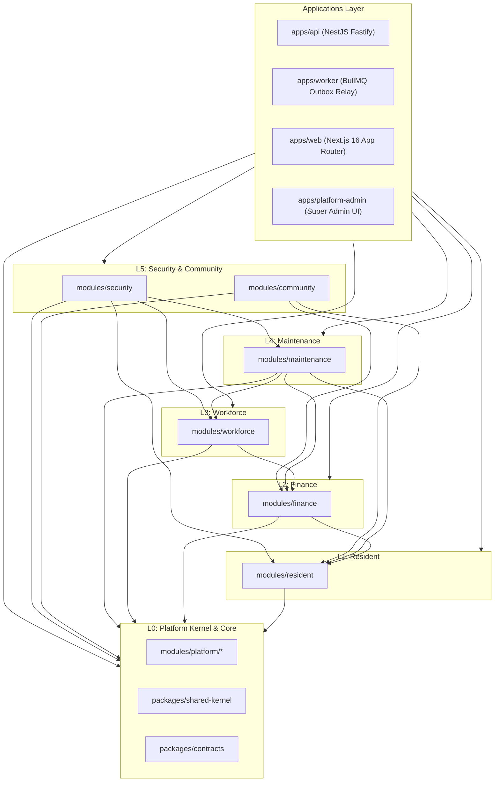

# Society ERP SaaS

[](https://github.com/anmolshende09/society-management-system/actions/workflows/ci.yml)
[](https://nodejs.org/)
[](https://pnpm.io/)
[](https://www.typescriptlang.org/)
[](https://nextjs.org/)
[](https://nestjs.com/)
[](https://www.postgresql.org/)
[](https://turbo.build/)
[-8A2BE2.svg>)](#2-architectural-pillars)

An enterprise-grade, India-first, multi-tenant property and housing society ERP SaaS platform. Each housing society operates as an isolated tenant within a shared-database, shared-schema PostgreSQL architecture strictly enforced by Row-Level Security (RLS).

---

## 1. Overview & Core Value Proposition

The platform connects resident and property management, maintenance billing, complaints and tasks, visitor and gate security, HRM, assets and vendors, inventory, finance and accounting, amenities, and community features in **one auditable, traceable workflow**:

```text
Resident -> Complaint -> Task -> Worker/Vendor -> Asset -> Inventory -> Completion -> Expense -> Accounting -> TallyPrime
```

The core value is **complete operational and financial traceability across modules**, not a disconnected list of features. Every rupee spent on maintenance is auditable back to the originating resident complaint, work order, material requisition, and vendor payment.

---

## 2. Architectural Pillars

### 2.1 Modular Monolith with Enforced DAG

Single deployment codebase with two container process types:

- `api`: NestJS Fastify HTTP entrypoint (composition root).
- `worker`: Standalone NestJS background process (BullMQ queues, schedulers, transactional outbox relay).

Synchronous module dependencies form a strict **Directed Acyclic Graph (DAG)**:

```text
Kernel (L0) ──> Resident (L1) ──> Finance (L2) ──> Workforce (L3) ──> Maintenance (L4) ──> Security & Community (L5)
```

- Module encapsulation is enforced via code structure and verified in CI using `dependency-cruiser` (`pnpm verify:boundaries`).
- Cross-module calls use **only** the owning module's `src/api/` contracts or published domain events.
- Cross-module entity references are plain `uuid` columns. There are **zero** cross-module database foreign keys.



### 2.2 PostgreSQL Row-Level Security (RLS) Multi-Tenancy

- **Shared-Database, Shared-Schema**: Housing societies are isolated using PostgreSQL Row-Level Security keyed on `tenant_id`.
- **Enforced Security Policies**: Every tenant table has `tenant_id uuid NOT NULL REFERENCES platform.tenant(id)` and `FORCE ROW LEVEL SECURITY`.
- **Transaction-Local Isolation**: All tenant queries execute inside `TenantTransaction` using transaction-local configuration:
  ```sql
  SELECT set_config('app.tenant_id', $1, true);
  ```
  _(The 3rd parameter `true` is mandatory)._ Session-level `SET` is strictly forbidden to prevent tenant context bleed across PgBouncer connections.
- **Fail-Closed**: If `app.tenant_id` is missing or unauthenticated, the RLS policy evaluates to `NULL` and returns 0 rows.
- **Non-Enumerating Responses**: Cross-tenant queries return `404 Not Found` rather than `403 Forbidden` to prevent resource existence enumeration.

### 2.3 Financial Safety & Gate G-FIN

- **Integer Paise Representation**: All monetary values are handled as integer paise (`bigint`) via the `Money` value object (`@society/shared-kernel`). Floating-point arithmetic (`number`, `float`) is strictly prohibited.
- **JSON Serialization**: Paise amounts in JSON API requests and responses are serialized as base-10 decimal strings (`"amountPaise": "125000"`).
- **Immutable Financial Ledgers**: Posted financial records are append-only. Corrections require credit/debit notes or reversal journals (no `UPDATE` or `DELETE`).
- **Gate G-FIN (REQ-FIN-001)**: Live payment gateway integrations (`finance.gateway.live`) and tax compliance modules (`finance.tax.enabled`) are locked by default. Activation requires formal sign-off in `platform.compliance_attestation` from a qualified financial controller.

### 2.4 Transactional Outbox & Domain Events

- Upward and lateral cross-module communications use asynchronous domain events published via the Transactional Outbox pattern.
- Database mutations and outbox records are committed in the same database transaction.
- Consumers are strictly idempotent, deduplicating `(consumer, eventId)` in `platform.processed_event`.

---

## 3. Monorepo Structure

```text
society-erp/
├── apps/
│   ├── web/                    # Next.js 16 App Router (Resident, Admin, Accountant portal, BFF)
│   ├── platform-admin/         # SaaS Super Admin UI (isolated deployment and auth)
│   ├── api/                    # NestJS Fastify HTTP server (composition root)
│   └── worker/                 # NestJS background worker (BullMQ, schedulers, outbox relay)
├── packages/
│   ├── contracts/              # Zod schemas, OpenAPI 3.1 specifications, event contracts
│   ├── shared-kernel/          # Pure domain value objects (Money), branded UUIDv7 IDs, Result type
│   ├── config/                 # Shared configs (ESLint, Prettier, tsconfig, dependency-cruiser)
│   └── testing/                # Test factories, fixtures, mock tenant context, RLS assertions
├── modules/
│   ├── platform/               # Kernel: identity, tenancy, notification, documents, audit, workflow, search, reporting-core
│   ├── resident/               # Properties, units, occupants, vehicles, resident directory
│   ├── finance/                # Charges, billing, invoices, payments, expenses, internal ledger, Tally sync
│   ├── workforce/              # Employees, shifts, attendance, leave, payroll
│   ├── maintenance/            # Complaints, tasks, work orders, assets, AMC, vendors, inventory
│   ├── security/               # Gates, guards, visitors, parcels, parking, patrols, emergency SOS
│   └── community/              # Amenities, notices, events, polls, meetings
├── db/
│   ├── migrations/             # Ordered, immutable, checksummed SQL migrations
│   ├── seeds/                  # Idempotent platform, development, test, and demo seeds
│   └── tests/                  # pgTAP isolation and constraint test suites
├── infra/
│   ├── docker/                 # Local docker compose (PostgreSQL, PgBouncer, Redis, MinIO, Mailpit)
│   └── terraform/              # IaC configurations (AWS Mumbai ap-south-1)
├── tools/                      # Standalone CLI tools (db bootstrap, migration runner, RLS verifier)
└── docs/                       # Technical specs (specs.md), ADRs, compliance registers, context
```

---

## 4. Quick Start & Local Setup

### 4.1 Prerequisites

- **Node.js**: `v22.12.0+` (production container uses `Node.js 24 LTS`)
- **pnpm**: `10.5.2` (via Corepack: `corepack enable && corepack prepare pnpm@10.5.2 --activate`)
- **Docker**: Docker Desktop or Docker Compose v2
- **Git**: 2.40+

### 4.2 Installation & Initialization

```bash
# 1. Clone the repository
git clone https://github.com/anmolshende09/society-management-system.git
cd society-management-system

# 2. Install workspace dependencies
pnpm install

# 3. Create local environment configuration
cp .env.example .env

# 4. Start local infrastructure services
docker compose -f infra/docker/compose.yaml up -d

# 5. Bootstrap database roles, schemas, migrations, and development seed data
pnpm db:bootstrap
pnpm db:migrate
pnpm db:seed:dev

# 6. Verify tenant isolation and RLS policies
pnpm db:verify

# 7. Start development servers
pnpm dev
```

### 4.3 Running Individual Services

You can run specific services using Turborepo filters:

```bash
pnpm --filter @society/api dev          # Start NestJS API Gateway (port 3001)
pnpm --filter @society/web dev          # Start Next.js Web App (port 3000)
pnpm --filter @society/platform-admin dev # Start Platform Admin App (port 3002)
pnpm --filter @society/worker dev       # Start BullMQ Background Worker
```

---

## 5. Development Scripts Reference

| Command                  | Description                                                    |
| ------------------------ | -------------------------------------------------------------- |
| `pnpm dev`               | Start development servers in parallel                          |
| `pnpm build`             | Build all 23 packages and apps via Turborepo                   |
| `pnpm typecheck`         | Strict TypeScript compilation across all packages              |
| `pnpm lint`              | Run workspace linter checks                                    |
| `pnpm format`            | Auto-format codebase with Prettier                             |
| `pnpm format:check`      | Verify formatting compliance with Prettier                     |
| `pnpm test`              | Run unit tests across modules using Vitest                     |
| `pnpm test:integration`  | Run integration tests (Testcontainers)                         |
| `pnpm verify:boundaries` | Enforce DAG and module boundary rules via `dependency-cruiser` |
| `pnpm db:bootstrap`      | Initialize local database roles, extensions, and schemas       |
| `pnpm db:migrate`        | Execute ordered, immutable, checksummed SQL migrations         |
| `pnpm db:seed:dev`       | Seed synthetic development data                                |
| `pnpm db:verify`         | Run RLS catalog check script to verify security policies       |
| `pnpm db:reset`          | Reset local database (strictly guarded for local development)  |

---

## 6. Team Collaboration Guidelines

Our engineering team works collaboratively using structured GitHub workflows:

1. **Branching**: Branch off `main` using standard prefixes:
   - `feature/<module>-<description>`
   - `fix/<module>-<description>`
   - `refactor/<module>-<description>`
   - `docs/<description>`
   - `chore/<description>`
2. **Conventional Commits**: Format commit messages systematically (`feat(resident): ...`, `fix(finance): ...`).
3. **Pre-PR Verification**: Every team member must ensure the 5 core checks pass before opening a PR:
   ```bash
   pnpm format:check && pnpm lint && pnpm typecheck && pnpm verify:boundaries && pnpm test
   ```
4. **Peer Review**: Open a PR using `.github/pull_request_template.md`. Require at least one teammate review and clean CI checks before merging.

For full collaboration instructions, review [`CONTRIBUTING.md`](./CONTRIBUTING.md).

---

## 7. Architecture Decision Records (ADRs)

Key architectural decisions are documented in [`docs/adr/`](./docs/adr/):

- [`ADR-001`](docs/adr/ADR-001-modular-monolith-architecture.md): Modular Monolith Architecture & Boundary Enforcement
- [`ADR-002`](docs/adr/ADR-002-postgresql-shared-schema-rls-tenancy.md): PostgreSQL Shared-Schema Tenancy with Row-Level Security
- [`ADR-003`](docs/adr/ADR-003-technology-stack-nextjs-nestjs-node.md): Technology Stack Baseline (Next.js 16, NestJS Fastify, Node.js 24)
- [`ADR-004`](docs/adr/ADR-004-orm-and-database-migrations-drizzle.md): Database Access via Drizzle ORM and Immutable Migration Ledger
- [`ADR-005`](docs/adr/ADR-005-mobile-delivery-strategy.md): Mobile Delivery Strategy (Responsive PWA First, Expo Native Phase 4)
- [`ADR-006`](docs/adr/ADR-006-financial-safety-and-gate-gfin.md): Financial Safety, Exact Integer Paise, and Gate G-FIN
- [`ADR-007`](docs/adr/ADR-007-authoritative-statutory-ledger.md): Authoritative Statutory Accounting Ledger & TallyPrime Posting Target
- [`ADR-008`](docs/adr/ADR-008-pilot-customer-scope-and-organization-model.md): Pilot Customer Scope, Multi-Property Organizations, and Escrow-Free Settlement

---

## 8. Governance & Specifications

- **Technical Specification**: [`specs.md`](./specs.md)
- **Agent Operating Constitution**: [`AGENTS.md`](./AGENTS.md)
- **Canonical Architecture Blueprint**: [`docs/canonical/architecture-blueprint.md`](./docs/canonical/architecture-blueprint.md)
- **Tenant Security Model**: [`docs/canonical/tenant-security-model.md`](./docs/canonical/tenant-security-model.md)
- **Financial Engineering Rules**: [`docs/canonical/financial-engineering-rules.md`](./docs/canonical/financial-engineering-rules.md)
- **Security Policy**: [`SECURITY.md`](./SECURITY.md)
- **Code of Conduct**: [`CODE_OF_CONDUCT.md`](./CODE_OF_CONDUCT.md)

---

## 9. License & Proprietary Notice

Copyright © 2026 Society ERP SaaS Team. All rights reserved.  
This software and associated documentation files are proprietary and confidential. Unauthorized copying, distribution, modification, or deployment via any medium is strictly prohibited.
